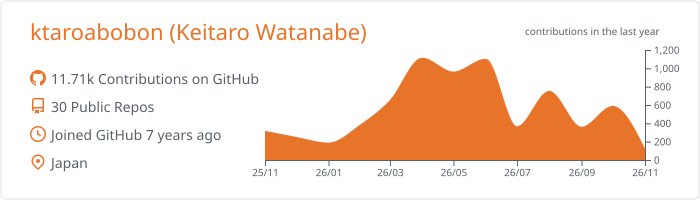
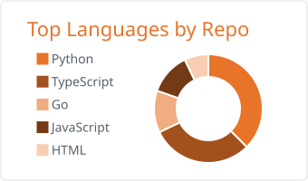
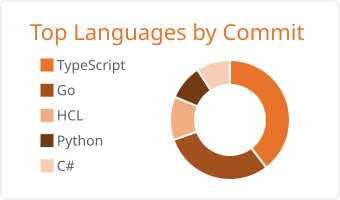
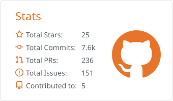
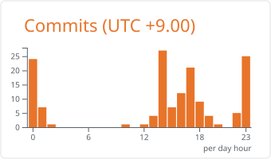
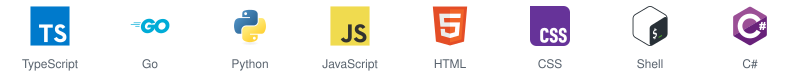

<a href="README.md">English</a> | <b>日本語</b>

# こんにちは、ktaroabobon (Keitaro Watanabe) です

日本で働くソフトウェアエンジニアです。

  
  
  
  

## GitHub の統計

  <picture>
    <source media="(prefers-color-scheme: dark)" srcset="assets/cards/dark/0-profile-details.svg">
    
  </picture>

  <picture>
    <source media="(prefers-color-scheme: dark)" srcset="assets/cards/dark/1-repos-per-language.svg">
    
  </picture>
  <picture>
    <source media="(prefers-color-scheme: dark)" srcset="assets/cards/dark/2-most-commit-language.svg">
    
  </picture>

  <picture>
    <source media="(prefers-color-scheme: dark)" srcset="assets/cards/dark/3-stats.svg">
    
  </picture>
  <picture>
    <source media="(prefers-color-scheme: dark)" srcset="assets/cards/dark/4-productive-time.svg">
    
  </picture>

## 技術スタック

#### 言語

<picture>
  <source media="(prefers-color-scheme: dark)" srcset="assets/stack/dark/languages.svg">
  
</picture>

#### フロントエンド

<picture>
  <source media="(prefers-color-scheme: dark)" srcset="assets/stack/dark/frontend.svg">
  
</picture>

#### バックエンド

<picture>
  <source media="(prefers-color-scheme: dark)" srcset="assets/stack/dark/backend.svg">
  
</picture>

#### データベース

<picture>
  <source media="(prefers-color-scheme: dark)" srcset="assets/stack/dark/database.svg">
  
</picture>

#### データと AI

<picture>
  <source media="(prefers-color-scheme: dark)" srcset="assets/stack/dark/data-and-ai.svg">
  
</picture>

#### インフラとツール

<picture>
  <source media="(prefers-color-scheme: dark)" srcset="assets/stack/dark/infra-and-tools.svg">
  
</picture>
