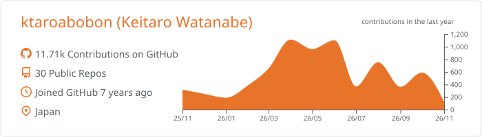
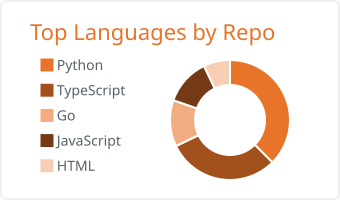
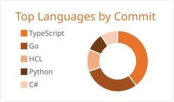
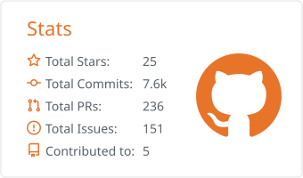
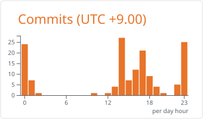

<b>English</b> | <a href="README.ja.md">日本語</a>

# Hi, I'm ktaroabobon (Keitaro Watanabe)

Software engineer based in Japan.

  
  
  
  

## GitHub stats

  <picture>
    <source media="(prefers-color-scheme: dark)" srcset="assets/cards/dark/0-profile-details.svg">
    
  </picture>

  <picture>
    <source media="(prefers-color-scheme: dark)" srcset="assets/cards/dark/1-repos-per-language.svg">
    
  </picture>
  <picture>
    <source media="(prefers-color-scheme: dark)" srcset="assets/cards/dark/2-most-commit-language.svg">
    
  </picture>

  <picture>
    <source media="(prefers-color-scheme: dark)" srcset="assets/cards/dark/3-stats.svg">
    
  </picture>
  <picture>
    <source media="(prefers-color-scheme: dark)" srcset="assets/cards/dark/4-productive-time.svg">
    
  </picture>

## Tech stack

<table>
  <tr><th colspan="8" align="left">Languages</th></tr>
  <tr>
    <td align="center" width="88">
      <picture>
        <source media="(prefers-color-scheme: dark)" srcset="assets/icons/dark/typescript.svg">
        
      </picture>
       TypeScript
    </td>
    <td align="center" width="88">
      <picture>
        <source media="(prefers-color-scheme: dark)" srcset="assets/icons/dark/go.svg">
        
      </picture>
       Go
    </td>
    <td align="center" width="88">
      <picture>
        <source media="(prefers-color-scheme: dark)" srcset="assets/icons/dark/python.svg">
        
      </picture>
       Python
    </td>
    <td align="center" width="88">
      <picture>
        <source media="(prefers-color-scheme: dark)" srcset="assets/icons/dark/javascript.svg">
        
      </picture>
       JavaScript
    </td>
    <td align="center" width="88">
      <picture>
        <source media="(prefers-color-scheme: dark)" srcset="assets/icons/dark/html.svg">
        
      </picture>
       HTML
    </td>
    <td align="center" width="88">
      <picture>
        <source media="(prefers-color-scheme: dark)" srcset="assets/icons/dark/css.svg">
        
      </picture>
       CSS
    </td>
    <td align="center" width="88">
      <picture>
        <source media="(prefers-color-scheme: dark)" srcset="assets/icons/dark/shell.svg">
        
      </picture>
       Shell
    </td>
    <td align="center" width="88">
      <picture>
        <source media="(prefers-color-scheme: dark)" srcset="assets/icons/dark/csharp.svg">
        
      </picture>
       C#
    </td>
  </tr>
  <tr><th colspan="8" align="left">Frontend</th></tr>
  <tr>
    <td align="center" width="88">
      <picture>
        <source media="(prefers-color-scheme: dark)" srcset="assets/icons/dark/react.svg">
        
      </picture>
       React
    </td>
    <td align="center" width="88">
      <picture>
        <source media="(prefers-color-scheme: dark)" srcset="assets/icons/dark/nextjs.svg">
        
      </picture>
       Next.js
    </td>
    <td align="center" width="88">
      <picture>
        <source media="(prefers-color-scheme: dark)" srcset="assets/icons/dark/vite.svg">
        
      </picture>
       Vite
    </td>
    <td align="center" width="88">
      <picture>
        <source media="(prefers-color-scheme: dark)" srcset="assets/icons/dark/tailwindcss.svg">
        
      </picture>
       Tailwind CSS
    </td>
    <td align="center" width="88">
      <picture>
        <source media="(prefers-color-scheme: dark)" srcset="assets/icons/dark/chakraui.svg">
        
      </picture>
       Chakra UI
    </td>
    <td align="center" width="88">
      <picture>
        <source media="(prefers-color-scheme: dark)" srcset="assets/icons/dark/threejs.svg">
        
      </picture>
       Three.js
    </td>
    <td></td>
    <td></td>
  </tr>
  <tr><th colspan="8" align="left">Backend</th></tr>
  <tr>
    <td align="center" width="88">
      <picture>
        <source media="(prefers-color-scheme: dark)" srcset="assets/icons/dark/hono.svg">
        
      </picture>
       Hono
    </td>
    <td align="center" width="88">
      <picture>
        <source media="(prefers-color-scheme: dark)" srcset="assets/icons/dark/bun.svg">
        
      </picture>
       Bun
    </td>
    <td align="center" width="88">
      <picture>
        <source media="(prefers-color-scheme: dark)" srcset="assets/icons/dark/fastapi.svg">
        
      </picture>
       FastAPI
    </td>
    <td align="center" width="88">
      <picture>
        <source media="(prefers-color-scheme: dark)" srcset="assets/icons/dark/flask.svg">
        
      </picture>
       Flask
    </td>
    <td align="center" width="88">
      <picture>
        <source media="(prefers-color-scheme: dark)" srcset="assets/icons/dark/django.svg">
        
      </picture>
       Django
    </td>
    <td align="center" width="88">
      <picture>
        <source media="(prefers-color-scheme: dark)" srcset="assets/icons/dark/firebase.svg">
        
      </picture>
       Firebase
    </td>
    <td></td>
    <td></td>
  </tr>
  <tr><th colspan="8" align="left">Database</th></tr>
  <tr>
    <td align="center" width="88">
      <picture>
        <source media="(prefers-color-scheme: dark)" srcset="assets/icons/dark/postgresql.svg">
        
      </picture>
       PostgreSQL
    </td>
    <td align="center" width="88">
      <picture>
        <source media="(prefers-color-scheme: dark)" srcset="assets/icons/dark/mysql.svg">
        
      </picture>
       MySQL
    </td>
    <td align="center" width="88">
      <picture>
        <source media="(prefers-color-scheme: dark)" srcset="assets/icons/dark/sqlite.svg">
        
      </picture>
       SQLite
    </td>
    <td align="center" width="88">
      <picture>
        <source media="(prefers-color-scheme: dark)" srcset="assets/icons/dark/redis.svg">
        
      </picture>
       Redis
    </td>
    <td align="center" width="88">
      <picture>
        <source media="(prefers-color-scheme: dark)" srcset="assets/icons/dark/prisma.svg">
        
      </picture>
       Prisma
    </td>
    <td align="center" width="88">
      <picture>
        <source media="(prefers-color-scheme: dark)" srcset="assets/icons/dark/drizzle.svg">
        
      </picture>
       Drizzle
    </td>
    <td></td>
    <td></td>
  </tr>
  <tr><th colspan="8" align="left">Data and AI</th></tr>
  <tr>
    <td align="center" width="88">
      <picture>
        <source media="(prefers-color-scheme: dark)" srcset="assets/icons/dark/pandas.svg">
        
      </picture>
       pandas
    </td>
    <td align="center" width="88">
      <picture>
        <source media="(prefers-color-scheme: dark)" srcset="assets/icons/dark/numpy.svg">
        
      </picture>
       NumPy
    </td>
    <td align="center" width="88">
      <picture>
        <source media="(prefers-color-scheme: dark)" srcset="assets/icons/dark/pytorch.svg">
        
      </picture>
       PyTorch
    </td>
    <td align="center" width="88">
      <picture>
        <source media="(prefers-color-scheme: dark)" srcset="assets/icons/dark/jupyter.svg">
        
      </picture>
       Jupyter
    </td>
    <td align="center" width="88">
      <picture>
        <source media="(prefers-color-scheme: dark)" srcset="assets/icons/dark/openai.svg">
        
      </picture>
       OpenAI
    </td>
    <td align="center" width="88">
      <picture>
        <source media="(prefers-color-scheme: dark)" srcset="assets/icons/dark/anthropic.svg">
        
      </picture>
       Anthropic
    </td>
    <td></td>
    <td></td>
  </tr>
  <tr><th colspan="8" align="left">Infra and tools</th></tr>
  <tr>
    <td align="center" width="88">
      <picture>
        <source media="(prefers-color-scheme: dark)" srcset="assets/icons/dark/docker.svg">
        
      </picture>
       Docker
    </td>
    <td align="center" width="88">
      <picture>
        <source media="(prefers-color-scheme: dark)" srcset="assets/icons/dark/githubactions.svg">
        
      </picture>
       GitHub Actions
    </td>
    <td align="center" width="88">
      <picture>
        <source media="(prefers-color-scheme: dark)" srcset="assets/icons/dark/ansible.svg">
        
      </picture>
       Ansible
    </td>
    <td align="center" width="88">
      <picture>
        <source media="(prefers-color-scheme: dark)" srcset="assets/icons/dark/homeassistant.svg">
        
      </picture>
       Home Assistant
    </td>
    <td align="center" width="88">
      <picture>
        <source media="(prefers-color-scheme: dark)" srcset="assets/icons/dark/vitest.svg">
        
      </picture>
       Vitest
    </td>
    <td align="center" width="88">
      <picture>
        <source media="(prefers-color-scheme: dark)" srcset="assets/icons/dark/playwright.svg">
        
      </picture>
       Playwright
    </td>
    <td></td>
    <td></td>
  </tr>
</table>
